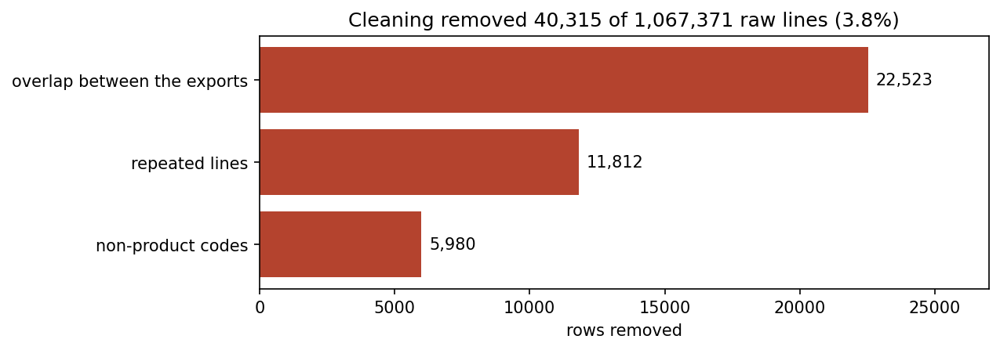
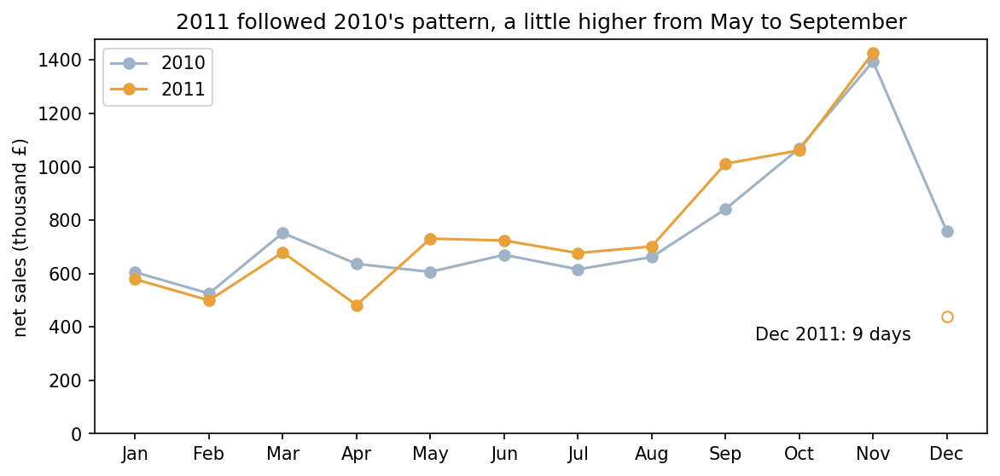
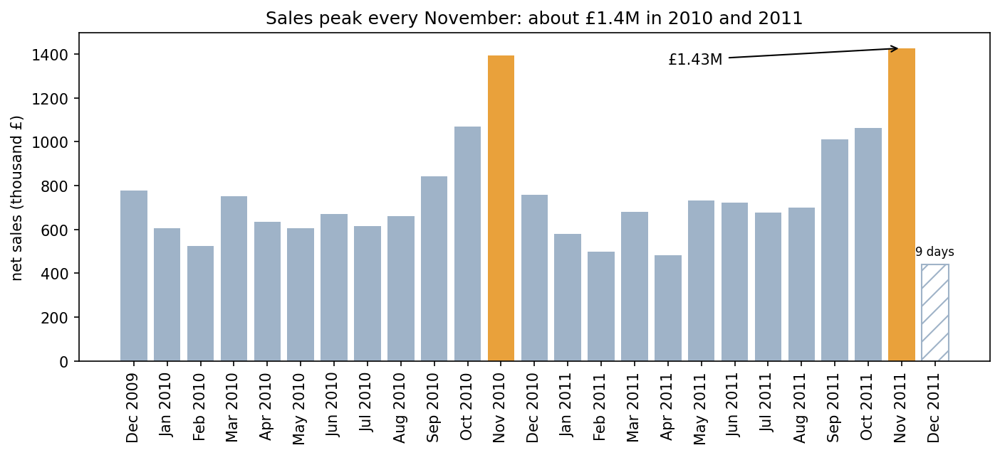
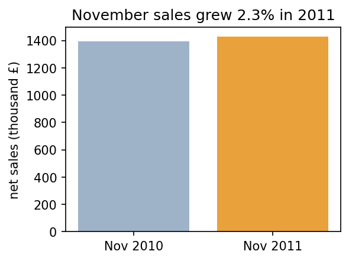
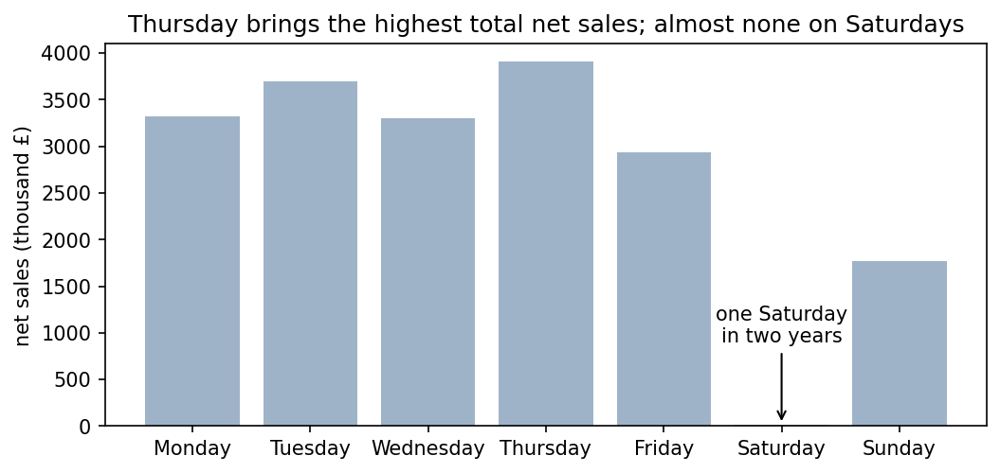
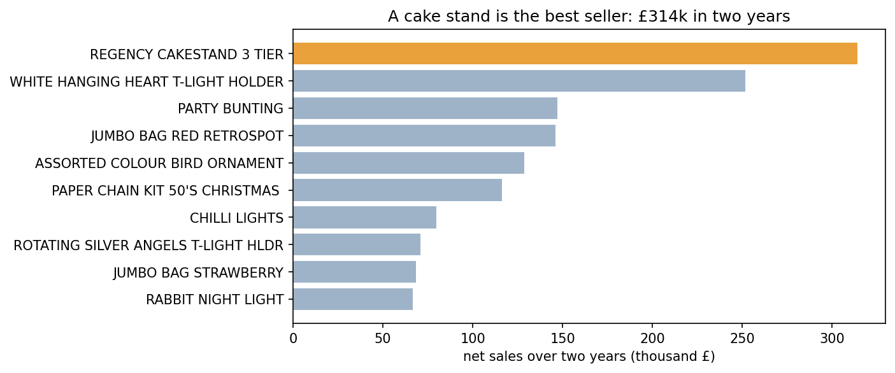

# Data Quality Report: Online Retail Sales (Dec 2009 – Dec 2011)

**Prepared by:** Brightside Insights  
**Data Source:** Online Retail II (Daqing Chen, UC Irvine Machine Learning Repository) — `online-retail-2009-2010.csv.gz` and `online-retail-2010-2011.csv.gz`  
**Data Cutoff:** 09 December 2011, 12:50 (last recorded transaction)  
**Primary Metric:** Net product-line revenue ($\text{Quantity} \times \text{Price}$ in GBP, net of cancellations)

---

## 1. Completeness (% of Values Populated)

| Field | Filled (%) | Status | Notes |
| :--- | :---: | :---: | :--- |
| `Invoice` | 100.0% | Pass | Complete |
| `StockCode` | 100.0% | Pass | Complete |
| `Description` | 99.6% | Acceptable | Missing values occur only on zero-price lines |
| `Quantity` | 100.0% | Pass | Complete |
| `InvoiceDate` | 100.0% | Pass | Complete |
| `Price` | 100.0% | Pass | Complete |
| `Customer ID` | 77.3% | Flagged | 22.7% guest/unassigned checkouts retained (see Section 4) |
| `Country` | 100.0% | Pass | Complete |

---

## 2. Validity Checks

| Validation Rule | Failing Rows (Raw) | Failing Rows (Clean) | Status |
| :--- | :---: | :---: | :---: |
| Quantity is never zero | 0 | 0 | Pass |
| Price is never negative | 5 | 0 | Pass |
| Negative quantities appear only on cancellations (`C`) or zero-price lines | 0 | 0 | Pass |
| Continuous date coverage (01 Dec 2009 – 09 Dec 2011) | 0 | 0 | Pass |
| Every priced line item includes a product description | 0 | 0 | Pass |

> **Note:** The 5 raw rows with negative prices correspond to `"Adjust bad debt"` entries (`StockCode: B`) and were removed during non-product filtering.

---

## 3. Data Cleaning Log

| Step | Rows Before | Rows After | Rows Removed | Revenue Impact (£) | Rationale |
| :--- | :---: | :---: | :---: | :---: | :--- |
| **1. Export Overlap** | 1,067,371 | 1,044,848 | 22,523 | -£377,488 | 01–09 Dec 2010 appears in both files; retained the `2010-2011` export copy. |
| **2. Duplicate Lines** | 1,044,848 | 1,033,036 | 11,812 | -£54,228 | Identical rows within a single file treated as duplicate recordings. |
| **3. Non-Product Codes** | 1,033,036 | 1,027,056 | 5,980 | +£70,732 | Removed postage, bank fees, manual adjustments, and bad-debt write-offs. |

### Methodological Judgments
* **Overlap Resolution:** Records from 01–09 Dec 2010 are identical across both source files; keeping the `2010-2011` copy eliminates double-counting without altering underlying values.
* **Deduplication:** Because source exports lack a line-item sequence ID, exact row duplicates within the same file are treated as system double-entries.
* **Product Scope:** Valid products are defined by stock codes starting with five digits. Non-merchandise entries (postage, fees, manual adjustments, and bad debt) are excluded from product revenue.

---

## 4. Retained Rows with Analytical Flags

Rather than deleting valid edge cases, the following records are retained in the clean dataset with boolean flags for downstream filtering:

| Analytical Flag | Rows Flagged | Share of Clean Rows | Net Revenue (£) | Classification Rule |
| :--- | :---: | :---: | :---: | :--- |
| `cancellation` | 17,914 | 1.7% | -£716,426 | Invoice ID begins with `C` |
| `stock_adjustment` | 5,928 | 0.6% | £0 | Unit price equals `£0.00` |
| `no_customer` | 232,833 | 22.7% | £2,567,652 | `Customer ID` is null |
| `partial_month` | 25,152 | 2.4% | £440,396 | Transactions occurring in Dec 2011 (1–9 Dec only) |

---

## 5. Impact on Headline Metrics

| Metric | Raw Exports | Cleaned Dataset | Net Variance |
| :--- | :---: | :---: | :---: |
| **Total Line Items** | 1,067,371 | 1,027,056 | -40,315 (-3.8%) |
| **Total Net Revenue** | £19,287,251 | £18,926,266 | -£360,985 (-1.9%) |
| **December 2010 Revenue** | £1,126,445 | £758,024 | -£368,421 (-32.7%) |

---

## 6. Post-Cleaning Sales & Seasonality Overview

The charts below reflect the validated dataset (`1,027,056` rows) and highlight key seasonal patterns and caveats:

### Two-Year & Monthly Revenue Trajectory

### Seasonal Peaks, Day-of-Week Trends & Top Products

---

## 7. Known Limitations & Caveats

1. **Incomplete Final Month (`partial_month`):** December 2011 includes only 9 days of activity (01–09 Dec). Exclude or prorate this period when running month-over-month comparisons.
2. **Unattributed Customer Revenue (`no_customer`):** 22.7% of line items lack a `Customer ID` (£2.57M in net revenue). Cohort, retention, and CLV analyses apply strictly to the identified 77.3% subset.
3. **Conservative Deduplication:** Treating identical intra-file lines as system duplicates may slightly understate revenue if genuine repeat orders occurred within the same timestamp.
4. **Orphaned Cancellations:** Revenue is reported net of cancellations, but 1,362 cancellation lines (totaling -£28,288) reference original orders placed prior to the 01 Dec 2009 dataset start date.
5. **Unverified Zero-Price Lines:** The 5,928 zero-price rows are inferred as inventory write-offs/adjustments based on text descriptions and have not been independently audited by the merchant.
